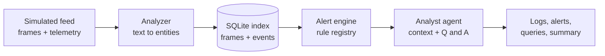

# Architecture

## Overview

The system is a single directional pipeline. Each stage has one job and hands a typed value to the next stage.

The same flow exists as plain text in `docs/TESTING.md` for readers without a Mermaid renderer.

## Stages

| Stage | Module | Responsibility |
| --- | --- | --- |
| Feed | `feed.py` | Produce a deterministic sequence of frames with telemetry |
| Analyzer | `analyzer.py` | Turn a frame description into structured entities |
| Indexer | `indexer.py` | Persist frames and events and answer queries |
| Alerts | `alerts.py` | Evaluate rules and emit alerts |
| Agent | `agent.py` | Hold rolling context, answer questions, summarize |
| Pipeline | `pipeline.py` | Wire the stages together |
| Entry point | `main.py` | Run and print the demo |

## Data shapes

The domain is a stream of observations. Encoding it as typed values keeps invalid states out and removes repeated shape assumptions.

| Type | Fields | Purpose |
| --- | --- | --- |
| `Telemetry` | timestamp, location, position, altitude_m | Where and when the drone was |
| `Entity` | kind, color, make, model, count | What was seen |
| `Frame` | id, timestamp, location, description, telemetry, entities | One observation |
| `SecurityEvent` | event_id, frame_id, timestamp, location, entity, summary | A logged detection |
| `Alert` | alert_id, rule, severity, message, timestamp, frame_id | A rule firing |

## Storage

SQLite is used through the standard library. Two tables store frames and events. Indices on `timestamp` and entity fields make the two required query patterns cheap.

- Frames are queried by time range.
- Events are queried by object kind, make, or model.

A file path makes the index persistent. An in-memory database is used when no path is given, which keeps tests isolated.

## Alert rules

Rules live in a registry. Each rule exposes `evaluate(events, frames, context)` and returns zero or more alerts. Adding a rule means adding one registry entry. There is no branch over rule names elsewhere in the system.

| Rule | Trigger | Severity |
| --- | --- | --- |
| `loitering_rule` | Person at the main gate between 00:00 and 05:00 | high |
| `repeat_entry_rule` | Same vehicle make and model seen at two distinct times | medium |

## Design decisions

| Decision | Chosen | Alternative | Why |
| --- | --- | --- | --- |
| Visual understanding | Text frames parsed by a keyword registry | A real VLM such as CLIP or BLIP | No VLM background, no model weights, and the assignment allows simulated frames |
| Agent framework | Plain Python classes | LangChain | No LangChain background and the logic fits in a few methods |
| Persistence | SQLite | JSON file or pandas | Built in, queryable, and no extra dependency |
| Rule dispatch | Registry of rule objects | `if`/`elif` chain | New rules do not touch existing code |
| Context | Rolling list of events stored in the agent | Full conversation state in an LLM | Deterministic and testable |

## Correctness and scalability notes

- Frames are processed in arrival order, and the feed is sorted by timestamp.
- The index is the single source of truth for queries. The agent reads from it rather than keeping a second copy.
- SQLite replaces the in-memory store by passing a file path, so the same code serves the demo and a longer recording.
- A production version would batch inserts, add a column store for large frame volumes, and swap the analyzer for a real VLM behind the same `analyze_frame` interface.
